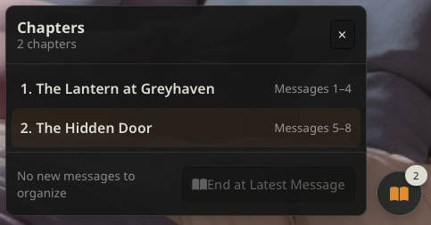
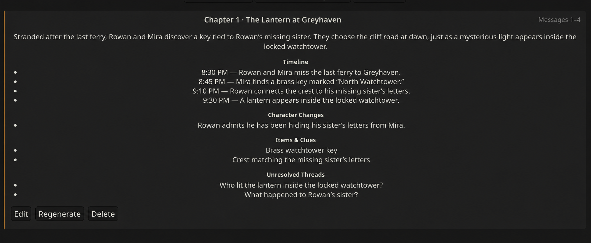

  <h1>୨୧ Chapter Journal ୨୧</h1>
  
<strong>A lightweight, AI-assisted organizer for long-form character conversations.</strong>

  
Manual chapter boundaries · Editable AI summaries · Fast conversation navigation

## Preview

## What it does

- You decide where each chapter ends.
- Your connected language model creates a title, summary, timeline, character changes, clues, and unresolved threads.
- Review, edit, or regenerate every chapter before saving it.
- Use the floating index to navigate long conversations.
- Export your chapter journal as Markdown.
- Keep an English interface while organizing multilingual conversations.

## Install

In SillyTavern, open **Extensions → Install Extension** and paste:

`https://github.com/wennshii/chapter-journal`

Then select **Install**.

## Use

Select the open-book icon on a message, or open the floating journal button and choose **End at Latest Message**. Review the generated record, then select **Save Chapter**.

Saved chapters stay in chat metadata and are never automatically injected into prompts.

## License

AGPL-3.0-or-later.
